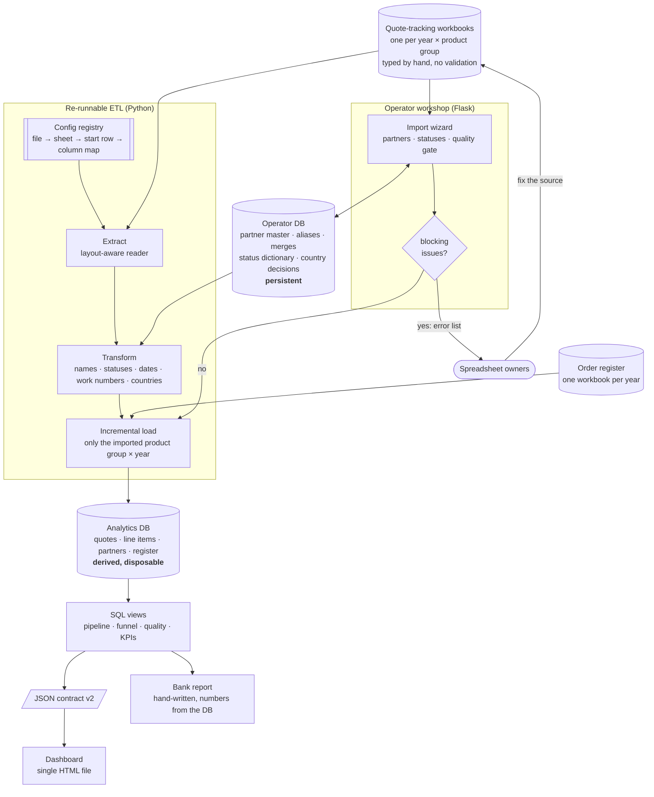

**English** · [Magyar](../hu/00-at-a-glance.md) · [↑ README](../../README.md)

# At a glance

## The system on one picture

## Fourteen decisions that define it

| # | decision | why | price paid |
|---|---|---|---|
| 1 | **One config registry** — a column map per layout era, a file entry per year. | Every year's spreadsheet had different columns; layout knowledge should be data, not branches in code. | A new layout still needs a new map written by someone who looked at the sheet. |
| 2 | **Two databases:** the analytics DB is fully derived and disposable; the operator DB holds every human decision. | A rebuild must never erase a judgement a person made (a merge, a country, a status). | Two sources to keep consistent; the ETL reads the operator DB on every run. |
| 3 | **Fix errors in the source, not in the database.** The error list goes back to the people who own the spreadsheets. | A patch in a derived DB is lost on the next rebuild and invisible to the people who keep typing the data. | Every round trip waits on someone else's time. |
| 4 | **Name matching in zones:** normalise → similarity score → green (auto) / yellow / red (a person decides). | A wrong merge silently moves revenue between customers; a missed merge only duplicates one. | The operator reviews hundreds of red names at the first import; far fewer afterwards. |
| 5 | **Every raw spelling is kept as an alias** of its canonical partner. | Next year the same misspelling is recognised without asking again; the trail stays auditable. | An alias table that has to be kept clean (and once grew on every run — fixed). |
| 6 | **A blocking quality gate** in the import wizard; overriding it requires a written reason. | Some errors (a won deal without an order number) break downstream reconciliation. | Imports can stall until the source is fixed. |
| 7 | **Status vocabulary as a mapping table** (42 spellings → 10 states), extensible by the operator. | Free-text status is the main input of every funnel number. | Two places to look (code map + operator dictionary). |
| 8 | **Incremental load** per product group × year. | Re-importing this year's file must not touch closed years. | Removing a year needs an explicit delete. |
| 9 | **Business logic in numbered SQL views**, exported through a **versioned JSON contract**; the HTML never touches the DB. | Every number on screen traces back to one view and one definition. | A metric change means editing SQL, not the page. |
| 10 | **Country = the entity we actually transact with**, not the group HQ; domestic/foreign is always derived from the country. | The analysis is about our market reach. It cuts both ways: a foreign group's local subsidiary we deal with locally is domestic; a locally registered company run entirely through its foreign parent is foreign. | Needs a methodology note — one "wrong-looking" row can make a reviewer distrust the whole table. |
| 11 | **Two year bases:** the funnel by request year, realised orders by register year with accrual. | A bank asks both "how much demand came in" and "how much was actually contracted this year". | Two "won" figures that differ — explained side by side, never merged. |
| 12 | **Live pipeline = quoted within the last 12 months**; older open quotes are flagged as stale, not counted. | Never-closed old quotes inflated the pipeline. | A threshold someone has to own. |
| 13 | **No guessed data.** An industry breakdown was removed when enrichment coverage turned out to be ~0%. | A phantom chart is worse than no chart in front of a bank. | A requested feature not delivered. |
| 14 | **Don't automate a workstream before it has a stable routine.** The bank report stays hand-written; its numbers always come from the DB. | Codifying a moving target freezes the wrong thing. | Manual work every quarter (~1 hour of refresh + writing). |

Each row is written out as a full decision record in [Decision records](adr.md).

## Who did what

| | |
|---|---|
| **Me** | took the request, turned it into the plan above, made the business definitions with the client, ran every import, reviewed every number |
| **Claude** | wrote the code to that plan, proposed implementations, ran the measurements I asked for |
| **The spreadsheet owners** | fixed their sources from the error lists — the loop only works because they did |

→ [How I worked](07-how-i-worked.md)

## Plan vs built

| planned | built | note |
|---|---|---|
| monthly KPI dashboard (5 core KPIs) | a one-page story dashboard with year and product-group switches | redesigned in Oct 2026 after two quarters of use |
| industry breakdown | **removed** | enrichment data never arrived — see decision 13 |
| loss reasons by cause (price, capacity, technical) | loss by status category only | a view for it exists, but the transform never fills the field — it is always empty |
| bank report | delivered, hand-written, 7 versions | numbers recomputed from the DB each time |
| partner enrichment from public company registers | only the country part landed (~96% coverage) | the rest is shelved |
