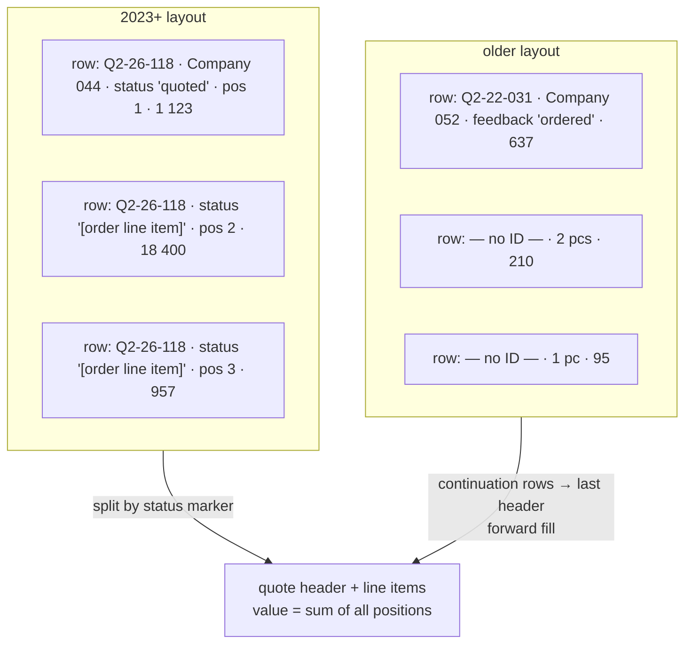

**English** · [Magyar](../hu/02-ingestion.md) · [↑ README](../../README.md)

# Ingestion — reading spreadsheets that change every year

## The problem in one sentence

Each year's workbook was laid out by whoever kept it that year: columns inserted, renamed,
reordered; one year split over two sheets; older years without a status column at all. A reader
with fixed column positions would not fail — it would **silently read the wrong field**.

## The decision: layout knowledge is data

All knowledge about *where things are* lives in one registry, `etl/config.py`:

```python
# a column map per layout era (1-based column numbers) — reusable building blocks
_TG1_COLS_LEGACY = {
    "quote_id": 2, "revision": 3, "partner_name": 4, "subject": 5,
    "request_date": 9, "deadline_date": 10, "sent_date": 12,
    "status": 13, "registry_number": 14, "total_value_eur": 15, "work_number": 16,
}
_TG1_COLS_2025 = {**_TG1_COLS_LEGACY, "country_domestic": 21, "country_name": 22, ...}

# one entry per importable file
FILE_CONFIG = {
    "TG1_2025": {"file": ROOT / "quotes_tg1_2025.xlsx", "sheet": "2025",
                 "start_row": 3, "cols": _TG1_COLS_2025},
    "TG1_2020": {"file": ROOT / "quotes_tg1_2020.xlsx",
                 "sheet": ["First half", "Second half"],        # one year, two sheets
                 "start_row": 4, "cols": _TG1_COLS_2022},       # no status column → tick boxes
    ...
}
```

*(Excerpt, simplified; file names synthetic.)*

**Adding a year is a config entry.** A changed layout is a new column map, usually a two-line
spread of the previous one. The extractor itself has no year-specific branches except one: whether
the file has a status column or not.

| | count (2026-10-13) |
|---|---:|
| file entries in the registry | 8 active + 4 archived years (kept, commented out) |
| column maps | 14 (8 quote layouts, 5 partner-sheet layouts, 1 contact layout) |
| fields per quote layout | 14–24 |

## The reader's rules

`etl/extract.py::_read_sheet` is a single, generic row reader (openpyxl, read-only, values only):

| rule | why |
|---|---|
| start at the configured row, map columns by the configured numbers | header rows differ in height and wording per year |
| stop after **20 consecutive empty rows** | sheets contain formatting and stray rows far below the data |
| a row needs an ID **and** a partner to count | placeholder rows (`-` in every cell) and half-typed rows are skipped |
| a sheet may be a **list** | one year was kept as two half-year sheets |
| `data/` wins over the project root | real files live in `data/`; same-named root files are fixtures (`config._resolve_file`) |

## Header rows and line items (product group 2)

Product group 2 quotes have line items. Two layouts exist:



*(Synthetic rows.)* The quote's value is the **sum of the header position and all line items**
(`transform.py::transform_tg2_quotes`); the line items are also kept in their own table.

## Where the status column does not exist

| layout | how status is recovered | code |
|---|---|---|
| product group 1, older years | five tick-box columns (won / lost / postponed / no quote / open) → a status string; no tick → "open" if a sent date exists, else "in preparation" | `extract.py::_derive_tg1_status_bitmask` |
| product group 2, oldest year | free-text feedback → keyword rules ("ordered" → won, "cancelled" → no quote, any other feedback after sending → lost) | `extract.py::_derive_tg2_status_feedback` |

The recovered string then goes through the same status map as every other year — one vocabulary
downstream.

## Missing and broken values

One set of markers means "no value" everywhere: `-`, `#N/A`, `#REF!`, "Missing, please fill in!"
(and its accent-free spelling), "no address", the empty string (`config.MISSING_MARKERS`). They are
turned into NULL *before* any rule looks at them, so a `#REF!` never becomes a partner called
`#REF!`.

## The same reader, two entry points

| entry | used for |
|---|---|
| `etl/run_etl.py` | the batch run: every configured file, end to end |
| the import wizard | an operator uploads one or more files; the file key (product group + year) is recognised from the file name, then the same extractor runs (`admin/routes/import_wizard.py`) |

## Plan vs built

| planned | built | note |
|---|---|---|
| read "the" spreadsheet | 8 layout eras behind one reader | the drift was only visible once all years were opened side by side |
| status from the status column | status from a column, tick boxes, or prose — one vocabulary after | older years would otherwise be unusable |
| load all years from 2020 | 2023+ loaded; 2020–2022 kept in the registry but switched off | those years were CRM-only and carried values in the wrong unit — they distorted the pipeline more than they informed it |
