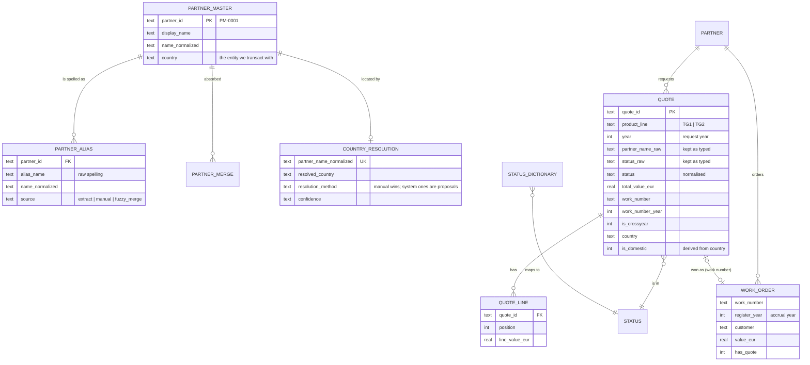

**English** · [Magyar](../hu/04-data-model.md) · [↑ README](../../README.md)

# Data model — what is derived, what is remembered

## Two databases, two lifetimes

The single most important structural decision: **separate what can be recomputed from what a
person decided.**

| | analytics DB (`etl/dashboard.db`) | operator DB (`admin/admin.db`) |
|---|---|---|
| content | quotes, line items, partners, aliases, anomalies, order register | partner master, aliases, merges, status dictionary, country decisions, import sessions + staging |
| origin | **fully derived** from the source workbooks + the operator DB | **human decisions** (and the wizard's working tables) |
| lifetime | disposable — can be deleted and rebuilt at any time | persistent — survives every rebuild |
| who writes | the ETL only | the operator, through the web app (and the country resolver) |
| if it is lost | run the ETL again | months of judgement are gone — this is the file to back up |

The rule that follows: **nothing in the analytics DB is ever edited by hand.** A wrong value is
fixed in the source workbook; a wrong judgement is fixed in the operator DB; then the ETL runs
again.

## The model



*Simplified; the derived `PARTNER` table mirrors the partner master plus batch-only partners.*

Three modelling choices worth naming:

| choice | why |
|---|---|
| **raw and normalised side by side** (`partner_name_raw` + `partner_id`, `status_raw` + `status`) | every derived value can be traced back to exactly what was typed — the first question in any data dispute |
| **natural keys from the business** (quote ID, work number) + **surrogate keys for partners** (`PM-xxxx`) | quote IDs and work numbers are what people say on the phone; a partner's name is not stable enough to be a key |
| **year as an attribute, not a partition** — plus `work_number_year` and `register_year` | the same deal belongs to different years depending on the question (see [Business definitions](06-business-definitions.md)) |

## Loading: incremental by product group × year

`etl/load.py::load_all` deletes and re-inserts **only the (product group, year) pairs present in
the current import**. Re-importing this year's file leaves closed years untouched; the views are
always dropped and recreated; the anomaly list is rebuilt on every run; the order register is
rebuilt in full.

| consequence | handled by |
|---|---|
| removing a year from the registry does **not** remove its rows | an explicit delete (documented) |
| a failure halfway through must not lose the year that was just deleted | an in-memory snapshot taken before the load and restored on any error — SQLite's `executescript` commits implicitly, so a plain rollback was not enough (found in review, fixed Oct 2026) |
| the derived alias table must not grow on every run | a unique key on (partner, alias, normalised name) — added in Oct 2026 after it had grown to 3× its real size |

## The reporting layer: numbered SQL views

Business logic lives in `sql/views/01_…09_*.sql`, loaded in order on every run:

| view | answers |
|---|---|
| `01_monthly_summary` | requests, quotes, value per month |
| `02_ytd_comparison` | the same calendar window across years |
| `03_loss_reasons` | losses by status category |
| `04_pipeline` | what is still open — and what is **live** (quoted within 12 months) vs stale |
| `05_market_summary` | domestic / foreign, countries, regions |
| `06_industry_summary` | *(kept, unfed — enrichment never arrived)* |
| `07_performance_scorecard` | win rate and conversion by outcome year |
| `08_data_quality` | missing country, missing date, unknown status … |
| `09_kpi_snapshot` | the headline figures |

To change a metric you edit SQL and re-run — the page is never the place where a number is computed.

## The contract to the page: JSON v2

`etl/export_json.py` queries the views (plus two Python-built sections) and writes one JSON file;
`etl/generate_dashboard.py` embeds it into a single HTML file. **The HTML never touches the
database** — every number on screen is in that file, and every section of the file names its
source (`_meta.sources`, e.g. *"sql/views/04_pipeline.sql (v_pipeline, is_live = 12 months)"*).

```text
{ _meta:   { contract: 2, as_of, years, pipeline_window_months, register{…}, sources{…} },
  quality: { … },
  scopes:  { all | tg1 | tg2: { years{ YEAR_BLOCK }, monthly[], pipeline{}, realized{}, quarterly[] } } }
```

`YEAR_BLOCK` uses exactly the definitions of the bank report (funnel by request year), so the
dashboard and the report cannot drift apart.

## Plan vs built

| planned | built | note |
|---|---|---|
| one database | two, with different lifetimes | the moment the first merge decision was made, it needed a home that a rebuild cannot erase |
| full rebuild on every run | incremental per product group × year | importing this quarter must not re-open closed years |
| metrics in the dashboard code | metrics in SQL views + a versioned JSON contract | the bank report and the dashboard read the same definitions |
