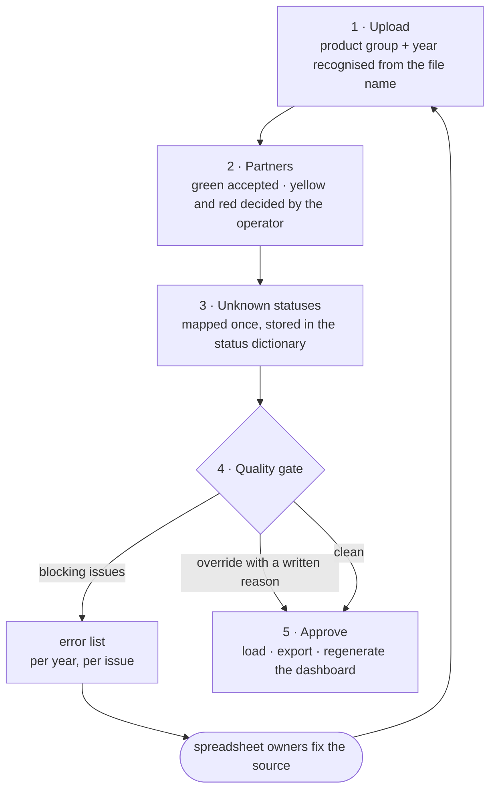

**English** · [Magyar](../hu/05-operator-workshop.md) · [↑ README](../../README.md)

# The operator workshop — bringing the people who type the data into the loop

## Why a workshop and not just a script

The errors in this data are not one-off. They are **typed in, every week, by people** who keep
the workbooks as part of their job. A script that silently cleans the data each quarter would
leave the cause untouched — and every new kind of error would need a developer.

So the pipeline got a small web app (Flask, 28 routes) where an operator imports the files, makes
the judgement calls, and produces an **error list that goes back to the spreadsheet owners**.

## The import, step by step

| step | what the operator sees | code |
|---|---|---|
| 1 upload | the files, the recognised product group and year, row counts | `admin/routes/import_wizard.py` |
| 2 partners | every new spelling with its best match, score and zone; red names also compared with each other | `admin/etl_bridge.py` (staging), [Entity resolution](03-entity-resolution.md) |
| 3 statuses | statuses no map knows, with how many quotes carry them | `import_wizard.py` (statuses), `admin/routes/status_dict.py` |
| 4 quality gate | blocking issues and warnings, per quote | `etl_bridge.py::collect_blocking_issues` |
| 5 approve | load into the analytics DB, export the JSON, regenerate the page | `etl_bridge.py` → the same ETL modules as the batch run |

The wizard does not have its own logic for reading or transforming: it **calls the same ETL
modules** as the batch run, so the operator path and the batch path cannot disagree on what a row
means.

## The quality gate

| issue | severity | why |
|---|---|---|
| won quote **without a work number** | **blocking** | the deal cannot be linked to the order register — the realised-revenue figures would silently miss it |
| raw partner name that matches nothing and was not decided | **blocking** | the quote would have no customer |
| country missing | warning | the domestic / foreign split would have a hole |
| request date missing | warning | same-period comparisons and reaction time go wrong |
| reaction time over 90 days | warning | usually a typo in a date |

A blocking issue can be overridden — but only with a **written reason**, stored with the
session and enforced on the server (until October 2026 only the form required it). "Fix it later" is possible; "fix it silently" is not.

## The loop, measured

Each year was imported on its own first (4–10 March 2026), then all active years together. The
first import of each year shows where the dirt was:

| year | blocking issues at its first import |
|---|---:|
| 2020 | 104 |
| 2021 | 167 |
| 2022 | 26 |
| 2023 | 0 |
| 2024 | 1 |
| 2025 | 9 |
| 2026 | 0–1 |

The oldest years — kept in a CRM before the workbooks — were by far the dirtiest; they were later
taken out of the load altogether (see [Ingestion](02-ingestion.md#plan-vs-built)). The active years
arrived almost clean, but the gate never goes quiet: the combined imports of June still stopped 3
and 7 rows, every one a won deal typed without its work number. The stopped rows went back to the
source and the next import passed — usually within a day.

*Source: the operator DB's import sessions (34 sessions, 4 March – 24 June 2026).* Across all
sessions the gate recorded 1,918 issues: 347 blocking (346 of them "won without a work number"),
1,571 warnings. Each year's error list went to the spreadsheet owners as a workbook, plus one
combined list for the active years.

## The second loop: the order register

In June 2026 the order register (what was actually contracted, per year) was connected. Matching
it to the quotes produced a second, categorised error list — written by
`scripts/extract_work_orders.py` as a workbook:

| category (October 2026 run) | count |
|---|---:|
| won quote, but no work number on the quote | 31 |
| order whose quote is not marked as won | 26 |
| order with no quote at all | 17 |
| suspicious accrual between years | 8 |
| to be reclassified (third division) | 6 |
| same work number on two customers | 6 |
| won quote without any order | 4 |
| typo in a work number | 4 |

*(The list had 110 items in the October report; the run of 13 October lists 112.)* The root cause
of the largest category was simple: work numbers had been recorded on only a fraction of won
quotes. The fix chosen was a **bulk list for the spreadsheet owners to fill in**, not a heuristic
that guesses the link.

## What else the workshop holds

| screen | for |
|---|---|
| partners | list, search, edit (country, notes), **merge** two partners with a reason, see every alias |
| status dictionary | the statuses operators added, editable |
| regenerate / reset | rebuild the page from the current DB; or reset the analytics DB and rebuild it from scratch |

## Plan vs built

| planned | built | note |
|---|---|---|
| a cleaning script | a cleaning script **and** an operator app around it | the judgement calls needed a place and a person |
| fix errors in the DB | an error list for the source owners | the next quarter's file would bring the same errors back |
| block every problem | two severities, override with a reason | a hard stop on a warning would have stalled every import |
