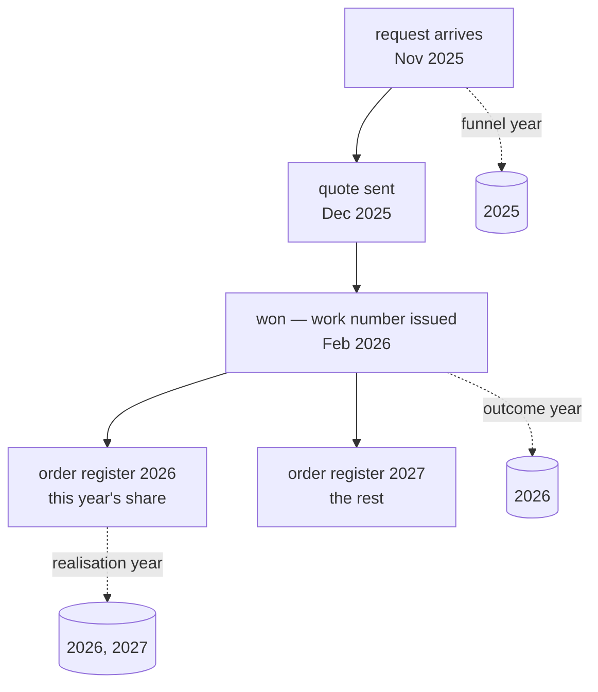
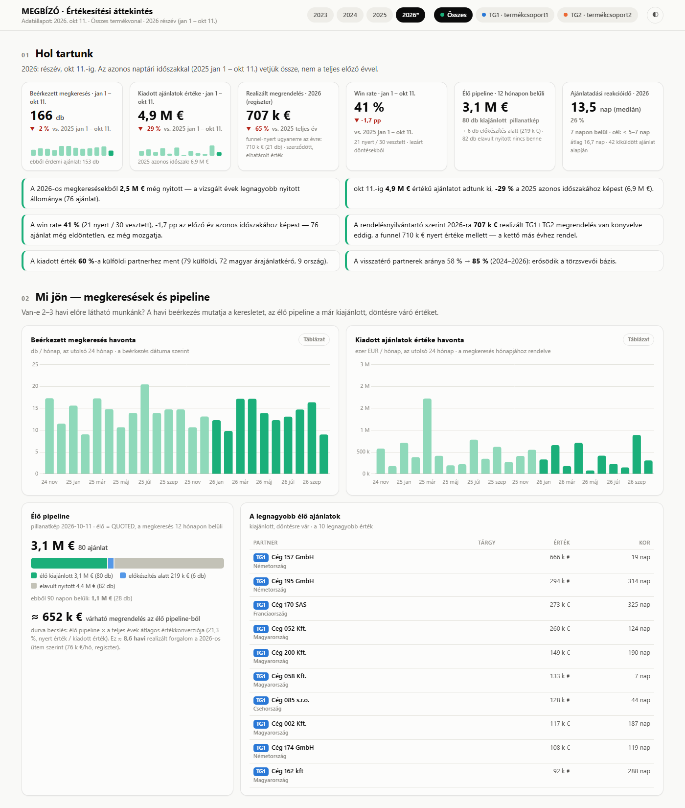

**English** · [Magyar](../hu/06-business-definitions.md) · [↑ README](../../README.md)

# Business definitions — how a number becomes defensible

Clean data is necessary, not sufficient. In front of a bank, *"how much did we quote last year?"*
has to give the same answer every time, from whoever computes it — and the answer has to survive
the follow-up question *"and how exactly did you count that?"*. That is a matter of **written
definitions**, decided once with the client, applied identically in the SQL, the dashboard and the
report.

## The definitions

| term | definition | the decision behind it |
|---|---|---|
| **requests** | every row: every incoming request for quotation | demand is measured by what came in, even if we never quoted it |
| **quoted value** | sum of values where status ≠ *no quote made* | a request we declined is not our offer — one declined mega-request would otherwise dwarf a whole year (see [The mess, D4](01-the-mess.md#d-rows-that-are-not-what-they-look-like)) |
| **won / lost / postponed** | status = won; status starts with *lost* (to a competitor or the customer cancelled); status = postponed | lost is two states on purpose: "the competitor won" and "the customer's project died" are different stories |
| **open** | quoted + in preparation | |
| **closed, no response** | a quote with no answer for 90–120 days, closed after the fact | **not counted as lost** — a deliberate decision: silence is not a "no". Measured per year, counting it as lost would cut product group 2's win rate several-fold (group 1 barely moves) |
| **win rate** | won / (won + lost), by count, decided quotes only | open and silent quotes do not dilute it |
| **conversion** | won value / quoted value | the money view; falls while a big pipeline is still open |
| **live pipeline** | quoted, requested within 12 months of the latest request in the data | older open quotes are **stale**, listed separately, to be closed in the source — they had inflated the pipeline (`sql/views/04_pipeline.sql`) |
| **domestic / foreign** | derived from the partner's country; country = the entity we transact with | see below |
| **new / returning partner** | first year the partner appears on that product group / appeared before | computed against the full history, including the archived years |

## Which year does a deal belong to?

The same deal can honestly belong to three different years:

| question | year basis | used in |
|---|---|---|
| "how much demand came in, and what did we do with it?" | **request year** | the funnel, the dashboard, the report's yearly tables |
| "how is our win rate developing?" | **outcome year** (work-number year, else request year) | the performance scorecard view |
| "how much was actually contracted this year?" | **register year, with accrual** — a multi-year order counts in each year with that year's share | realised revenue (order register) |

The two "won" figures — funnel *won* by request year and *realised* by register year — **differ,
and both are right**. They are always shown side by side with this explanation, never merged.
A deal that crosses the year boundary is flagged (`is_crossyear`) so it can be explained, not hidden.

## Same period, partial year, projection

- **Same period:** comparisons with earlier years use the **same calendar window** (1 January → the
  latest request date this year), not the full previous year.
- **Partial year:** the current year is always labelled as partial.
- **Projection:** a linear annualisation (365 / days elapsed), shown separately and labelled as
  such — never mixed into a fact table.

## Country — and the methodology note

The domestic / foreign split is the core of the bank report. The rule — **country = the entity we
actually transact with** — is analytically right and occasionally looks wrong: a locally
registered company can be "foreign" because every contact, order and invoice goes to its group's
plant abroad; a foreign group's local subsidiary is "domestic".

One such row, unexplained, can make a reviewer distrust the whole table. So every country split
shown to an outsider carries a short **methodology note naming one such case type**. The decisions
themselves are stored per partner in the operator DB (331 manual decisions), so they are applied
identically every quarter.

## What the definitions feed

**The bank report** — hand-written, every number recomputed from the database on each refresh:
yearly funnel per product group split domestic / foreign / total; the same-period comparison; a
projection for the partial year; realised orders from the register; new vs returning partners;
geographic spread. Now at version 7; every version since v4 is kept side by side.

**The dashboard** — one scrollable page with year and product-group switches; every chart has a
table twin; every section names its definition. It exists and it is used — but it is the least
interesting part of this project: the work is in making its numbers true.

*Rendered from the synthetic dataset in this repository — no real figures. The labels are Hungarian, as in production: "Hol tartunk" = where we stand, "Mi jön" = what is coming, "Élő pipeline" = live pipeline.*

## Plan vs built

| planned | built | note |
|---|---|---|
| "show the numbers" | written definitions, applied identically in SQL, page and report | the definitions were the deliverable the bank actually needed |
| one "won" figure | two, side by side, with the year basis named | merging them would have been simpler and wrong |
| closed-no-response = lost | kept separate, not counted as lost | a business decision, recorded as one |
| pipeline = everything open | live (12 months) vs stale | the old open quotes were noise, not opportunity |
