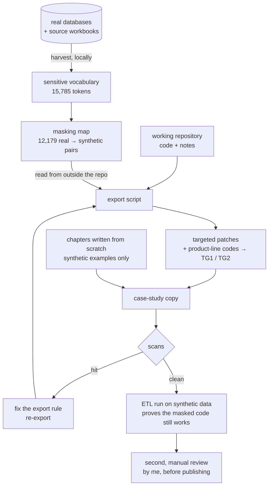

**English** · [Magyar](../hu/10-data-protection.md) · [↑ README](../../README.md)

# Data protection — how this repository was anonymised

This project was built on a client's commercial data: customer names, contacts, prices, deals.
None of it is in this repository. If you hire me to work on your data, this is how I would treat
yours — so the procedure is documented here, including what it caught.

## The rules

| rule | in practice |
|---|---|
| **the client is not named** | not the company, not the industry, not the products — the two product lines are *product group 1 / 2* (`TG1` / `TG2` in code) |
| **no real record, value or identifier** | every company, person, quote number, work number and amount in the docs, the code and the screenshot is synthetic |
| **only aggregate counts** | the metrics are counts of rows and decisions (e.g. "331 manual country decisions"), measured on the live system — no value, no name, no per-customer figure |
| **the masking material never enters the repository** | the list of real names and the masking map live only on the machine that holds the data |
| **a fresh repository** | built by an export script, with no git history from the working repository |

## The procedure

1. **Harvest.** A dedicated agent, working only locally, collected every sensitive token from the
   real databases and documents: company names and every spelling of them, normalised forms,
   distinctive brand words, person names, e-mail addresses and domains, product and industry terms,
   source file and sheet names, the client's own name in every spelling, personal paths — 15,785
   tokens covering 1,024 company groups and 1,513 people. Generic words (country names, "group",
   "service" …) were kept out of the list on purpose and reviewed separately, so the scanner stays
   meaningful.
2. **Mask.** A real → synthetic map (`Cég 0001`, `Kapcsolattartó 0001`, `termékcsoport1` …) is
   applied to every exported code file. A token is replaced only where it stands as a word — not
   glued to letters or digits — and country names are never masked.
3. **Patch.** What a literal map cannot fix is rewritten by name-free rules in the export script: a
   hard-coded customer → country hint table is emptied; a methodology note that named real cases
   now describes the case *types*; a cross-check pinned to a real count keeps its mechanism but not
   its number; work-number examples move to a synthetic 900+ serial block; an industry code used
   as a form placeholder and a comment listing customer segments are neutralised; the product-line
   codes become `TG1` / `TG2` in identifiers, SQL and labels.
4. **Write the docs from scratch.** No chapter is an edited copy of a project note; every example
   row was invented for the error *type* it illustrates.
5. **Scan** — see below. Any hit changes the export rule, never the output by hand, and the export
   runs again.
6. **Run it.** The exported ETL runs end to end on the synthetic dataset
   (`samples/generate_synthetic.py`); the dashboard image in this repository is its output.
7. **Review by hand** before anything is published.

## The scans

| scan | looks for | result on the final copy |
|---|---|---|
| real-name list | all 15,785 tokens, case-insensitive, anywhere — plus 448 short tokens as whole words | 0 real names; the remaining hits are fragments inside ordinary Hungarian words (reviewed one by one) |
| value scan | every number of 3+ digits against the 5,077 distinct amounts in the real data | 0 real amounts; remaining matches are code constants (CSS weights, HTTP codes, ports), the metric counts, and the synthetic 900-block |
| identifier patterns | real quote-number, registry-number and work-number shapes, tax and VAT numbers | only the generic `PM-0001` surrogate-key example |
| generic scanner | e-mail addresses, IBAN, tax numbers, IPs, secrets, personal paths, other projects | clean (form placeholders are all-zero) |
| word stems | stems of every product and industry term, so a truncated form cannot slip through | 0 |
| leftover product-line codes | the original two-letter codes in any identifier form | none |
| diff review | every code line the export changed, read in full | no broken code; every change intended |

## What the scans caught — honestly

The procedure exists because the first attempts were not clean. Each of these was caught before
anything left the machine:

| caught | by | fix |
|---|---|---|
| the first masking pass replaced short tokens **inside** words — it broke SQL `INTEGER`, HTTP `POST` and a function call | diff review | word-boundary matching; tokens of two characters or fewer and country names never masked |
| a hyphenated spelling of a real company, in a methodology note, was missing from the map | name scan | the note now describes the case types instead of naming cases |
| three amounts in a doc example were **real line values**, written from memory by the AI after an earlier session on the data | the AI itself, re-reading its draft — before any value scan existed | the value scan was added, and now runs on every export |
| a real yearly count pinned in a cross-check | running the export on synthetic data (the check failed) | mechanism kept, value removed |
| a **truncated product word** (a word stem, not the full term) in the import wizard's file-type detection and the upload page | a fresh-eyes reviewer agent reading the finished repo — the name scan only knew full words | detection now keys on the neutral `tg1` / `tg2` markers; a **word-stem scan** was added |
| an industry code as a form placeholder; a comment listing customer segments | value scan; manual review | neutralised |

The lesson I took: **an AI that has worked on the real data carries it in its context.** Masking
the code is not enough — anything written afterwards, docs included, has to go through the same
scans as the code.

## What is still "real" here — on purpose

- **Aggregate counts** about the system and the work (rows, decisions, sessions, issues). They
  describe the effort, not the business, and do not identify anyone.
- **The method and its vocabulary**: the column-layout eras, the Hungarian status words, the error
  types. That is the subject of this case study.
- **Generic product attributes** in the line-item model (type, material, quantity, a size
  parameter). The one attribute that pointed at the product's shape was renamed.

## Plan vs built

| planned | built |
|---|---|
| "replace the company names" | a harvested vocabulary, a masking map kept outside the repo, name-free patch rules, seven scans, a diff review, a synthetic run, a manual review |
| scan once at the end | scan after every export — every hit changed a rule, not the output |
| the code is the risk | the docs were a risk too: the AI that wrote them had seen the data |
