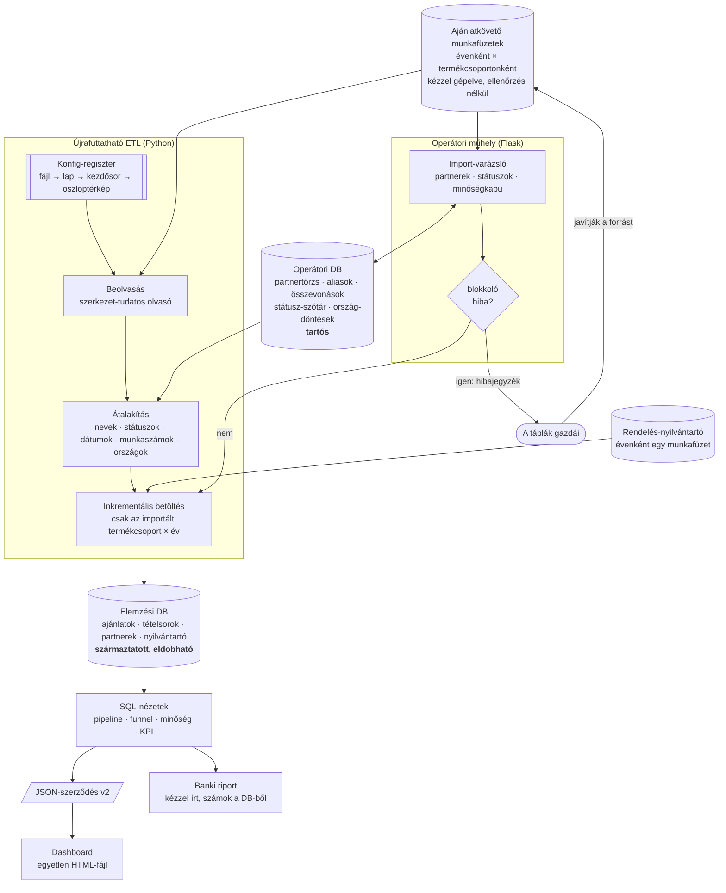

[English](../en/00-at-a-glance.md) · **Magyar** · [↑ README](../../README.hu.md)

# Áttekintés

## A rendszer egy ábrán

## Tizennégy döntés, ami meghatározza

| # | döntés | miért | ára |
|---|---|---|---|
| 1 | **Egy konfig-regiszter** — elrendezés-korszakonként oszloptérkép, évenként fájl-bejegyzés. | Minden év táblájában mások voltak az oszlopok; a szerkezet-tudás legyen adat, ne elágazás a kódban. | Egy új elrendezéshez továbbra is kell valaki, aki megnézi a lapot és megírja a térképet. |
| 2 | **Két adatbázis:** az elemzési DB teljesen származtatott és eldobható; az operátori DB-ben él minden emberi döntés. | Egy újraépítés soha nem törölhet ki emberi ítéletet (összevonást, országot, státuszt). | Két forrást kell összhangban tartani; az ETL minden futáskor olvassa az operátori DB-t. |
| 3 | **A hibát a forrásban javítjuk, nem az adatbázisban.** A hibajegyzék visszamegy a táblák gazdáihoz. | A származtatott DB-ben végzett javítás a következő újraépítéskor elveszik, és láthatatlan azoknak, akik tovább gépelik az adatot. | Minden kör más idejére vár. |
| 4 | **Név-egyezés zónákban:** normalizálás → hasonlósági pontszám → zöld (automatikus) / sárga / piros (ember dönt). | A hibás összevonás csendben bevételt tesz át egyik vevőről a másikra; a kimaradt összevonás csak duplikál. | Az első importnál az operátor több száz piros nevet néz át; később sokkal kevesebbet. |
| 5 | **Minden nyers írásmód aliasként megmarad** a kanonikus partner alatt. | Jövőre ugyanazt az elírást kérdezés nélkül felismeri; a nyomvonal visszakereshető. | Egy alias-tábla, amit tisztán kell tartani (és ami egyszer futásonként nőtt — javítva). |
| 6 | **Blokkoló minőségkapu** az import-varázslóban; felülbírálni csak írásos indokkal lehet. | Egyes hibák (megnyert üzlet munkaszám nélkül) eltörik a későbbi egyeztetést. | Az import megállhat, amíg a forrást nem javítják. |
| 7 | **Státusz-szótár leképező táblaként** (42 írásmód → 10 állapot), az operátor bővítheti. | A szabad szöveges státusz minden funnel-szám fő bemenete. | Két helyen kell nézni (kódbeli térkép + operátori szótár). |
| 8 | **Inkrementális betöltés** termékcsoport × év szerint. | Az idei fájl újraimportálása nem nyúlhat a lezárt évekhez. | Egy év eltávolításához kifejezett törlés kell. |
| 9 | **Üzleti logika számozott SQL-nézetekben**, **verziózott JSON-szerződésen** keresztül exportálva; a HTML sosem nyúl a DB-hez. | Minden képernyőn látható szám egy nézetre és egy definícióra vezethető vissza. | Egy metrika módosítása SQL-szerkesztés, nem az oldalé. |
| 10 | **Ország = akivel ténylegesen üzletelünk**, nem a csoport-központ; a belföldi/külföldi jelző mindig az országból származik. | Az elemzés a mi piaci elérésünkről szól. Mindkét irányba vág: egy külföldi csoport hazai leánya, akivel itthon üzletelünk, hazai; egy itthon bejegyzett cég, amelynek minden ügye a külföldi anyacégen fut, külföldi. | Módszertani megjegyzés kell — egy „rossznak látszó" sor miatt egy átnéző az egész táblában kételkedhet. |
| 11 | **Kétféle év-alap:** a funnel az ajánlatkérés éve szerint, a realizált rendelés a nyilvántartás éve szerint, időbeli elhatárolással. | A bank azt is kérdezi, „mennyi kereslet jött be", és azt is, „mennyit szerződtünk idén ténylegesen". | Két eltérő „megnyert" szám — egymás mellett magyarázva, sosem összemosva. |
| 12 | **Élő pipeline = az utolsó 12 hónapban kiajánlott**; a régebbi nyitott ajánlat elavultként jelölve, nem számolva. | A soha le nem zárt régi ajánlatok felfújták a pipeline-t. | Egy küszöb, amiért valakinek felelnie kell. |
| 13 | **Nincs becsült adat.** Az iparági bontás kikerült, amikor kiderült, hogy a dúsító adat lefedettsége ~0%. | Bank előtt a fantom-grafikon rosszabb, mint a semmilyen. | Egy kért funkció nem készült el. |
| 14 | **Amíg egy munkaágnak nincs stabil rutinja, nem automatizáljuk.** A banki riport kézzel írt; a számai mindig a DB-ből jönnek. | Mozgó célt kódba önteni a rossz dolgot fagyasztja be. | Negyedévente kézi munka (~1 óra frissítés + írás). |

Minden sor teljes döntés-rekordként: [Döntés-rekordok](adr.md).

## Ki mit csinált

| | |
|---|---|
| **Én** | átvettem az igényt, tervvé alakítottam, a megbízóval meghoztam az üzleti definíciókat, minden importot én futtattam, minden számot átnéztem |
| **Claude** | megírta a kódot e terv szerint, megvalósításokat javasolt, lefuttatta a kért méréseket |
| **A táblák gazdái** | a hibajegyzékekből javították a forrást — a kör csak azért működik, mert megtették |

→ [Hogyan dolgoztam](07-how-i-worked.md)

## Terv vs megépült

| terv | megépült | megjegyzés |
|---|---|---|
| havi KPI-dashboard (5 fő KPI) | egyoldalas „történet"-dashboard év- és termékcsoport-választóval | 2026 októberében újratervezve, két negyedév használat után |
| iparági bontás | **kikerült** | a dúsító adat sosem érkezett meg — lásd 13. döntés |
| elvesztés okai (ár, kapacitás, műszaki) | csak státusz-kategória szerint | van rá nézet, de az átalakítás sosem tölti ki a mezőt — mindig üres |
| banki riport | elkészült, kézzel írt, 7 változat | a számok minden alkalommal a DB-ből újraszámolva |
| partner-dúsítás nyilvános cégadatokból | csak az ország-rész valósult meg (~96% lefedettség) | a többi parkolópályán |
