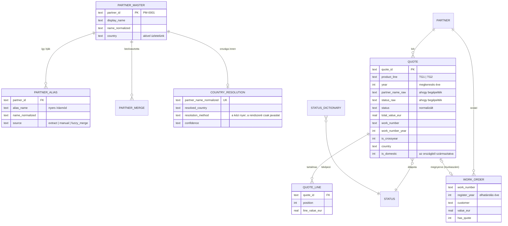

[English](../en/04-data-model.md) · **Magyar** · [↑ README](../../README.hu.md)

# Adatmodell — mi származtatott, mi az, amire emlékezni kell

## Két adatbázis, két élettartam

A legfontosabb szerkezeti döntés: **különválasztani azt, ami újraszámolható, attól, amiről ember
döntött.**

| | elemzési DB (`etl/dashboard.db`) | operátori DB (`admin/admin.db`) |
|---|---|---|
| tartalom | ajánlatok, tételsorok, partnerek, aliasok, anomáliák, rendelés-nyilvántartó | partnertörzs, aliasok, összevonások, státusz-szótár, ország-döntések, import-menetek + staging |
| eredet | **teljesen származtatott** a forrás-munkafüzetekből + az operátori DB-ből | **emberi döntések** (és a varázsló munkatáblái) |
| élettartam | eldobható — bármikor törölhető és újraépíthető | tartós — minden újraépítést túlél |
| ki írja | csak az ETL | az operátor, a webalkalmazáson keresztül (és az ország-feloldó) |
| ha elveszik | újra lefuttatjuk az ETL-t | hónapok ítéletei vesznek oda — ezt a fájlt kell menteni |

Ebből következik a szabály: **az elemzési DB-ben soha semmit nem szerkesztünk kézzel.** A rossz
értéket a forrás-munkafüzetben javítjuk; a rossz ítéletet az operátori DB-ben; aztán újra fut az ETL.

## A modell



*Egyszerűsítve; a származtatott `PARTNER` tábla a partnertörzset tükrözi, kiegészítve a csak
kötegelt futásból származó partnerekkel.*

Három modellezési döntés, amelyet érdemes megnevezni:

| döntés | miért |
|---|---|
| **nyers és normalizált egymás mellett** (`partner_name_raw` + `partner_id`, `status_raw` + `status`) | minden származtatott érték pontosan visszavezethető arra, amit begépeltek — ez az első kérdés minden adatvitában |
| **az üzlet természetes kulcsai** (ajánlatszám, munkaszám) + **helyettesítő kulcs a partnereknek** (`PM-xxxx`) | az ajánlatszámot és a munkaszámot mondják az emberek telefonon; egy partner neve nem elég stabil ahhoz, hogy kulcs legyen |
| **az év attribútum, nem partíció** — mellette `work_number_year` és `register_year` | ugyanaz az üzlet a kérdéstől függően más-más évhez tartozik (lásd [Üzleti definíciók](06-business-definitions.md)) |

## Betöltés: inkrementálisan, termékcsoport × év szerint

Az `etl/load.py::load_all` **csak az aktuális importban szereplő (termékcsoport, év) párokat** törli
és tölti be újra. Az idei fájl újraimportálása a lezárt éveket érintetlenül hagyja; a nézeteket
mindig eldobja és újra létrehozza; az anomálialista minden futáskor újraépül; a
rendelés-nyilvántartó teljes egészében újraépül.

| következmény | hogyan kezeljük |
|---|---|
| ha egy évet kiveszünk a regiszterből, a sorai **nem** törlődnek | kifejezett törléssel (dokumentálva) |
| egy félúton bekövetkező hiba nem veszítheti el az épp törölt évet | a betöltés előtt memóriabeli pillanatkép, bármely hibánál visszaállítva — az SQLite `executescript` implicit commitot végez, így egy sima rollback nem volt elég (átnézésben derült ki, 2026 októberében javítva) |
| a származtatott alias-tábla nem nőhet minden futáskor | egyedi kulcs (partner, alias, normalizált név) szerint — 2026 októberében került be, miután a tábla a valós méretének háromszorosára nőtt |

## A riportréteg: számozott SQL-nézetek

Az üzleti logika a `sql/views/01_…09_*.sql` fájlokban él, minden futáskor sorrendben betöltve:

| nézet | mire felel |
|---|---|
| `01_monthly_summary` | megkeresések, ajánlatok, érték havonta |
| `02_ytd_comparison` | ugyanaz a naptári időablak évek között |
| `03_loss_reasons` | elvesztések státusz-kategória szerint |
| `04_pipeline` | mi nyitott még — és mi **élő** (12 hónapon belül kiajánlott) vs elavult |
| `05_market_summary` | belföldi / külföldi, országok, régiók |
| `06_industry_summary` | *(megtartva, adat nélkül — a dúsítás sosem érkezett meg)* |
| `07_performance_scorecard` | win rate és konverzió a kimenet éve szerint |
| `08_data_quality` | hiányzó ország, hiányzó dátum, ismeretlen státusz … |
| `09_kpi_snapshot` | a főszámok |

Egy metrika módosításához SQL-t szerkesztünk és újrafuttatunk — az oldal soha nem az a hely, ahol
egy szám kiszámolódik.

## A szerződés az oldal felé: JSON v2

Az `etl/export_json.py` lekérdezi a nézeteket (plusz két Pythonban épített szakaszt), és egyetlen
JSON-fájlt ír; az `etl/generate_dashboard.py` ezt egyetlen HTML-fájlba ágyazza. **A HTML sosem nyúl
az adatbázishoz** — minden képernyőn látható szám ebben a fájlban van, és a fájl minden szakasza
megnevezi a forrását (`_meta.sources`, pl. *„sql/views/04_pipeline.sql (v_pipeline, is_live = 12
months)"*).

```text
{ _meta:   { contract: 2, as_of, years, pipeline_window_months, register{…}, sources{…} },
  quality: { … },
  scopes:  { all | tg1 | tg2: { years{ YEAR_BLOCK }, monthly[], pipeline{}, realized{}, quarterly[] } } }
```

A `YEAR_BLOCK` pontosan a banki riport definícióit használja (funnel a megkeresés éve szerint), így
a dashboard és a riport nem tud elcsúszni egymástól.

## Terv vs megépült

| terv | megépült | megjegyzés |
|---|---|---|
| egy adatbázis | kettő, eltérő élettartammal | abban a pillanatban, hogy megszületett az első összevonási döntés, kellett neki egy otthon, amit egy újraépítés nem törölhet |
| teljes újraépítés minden futáskor | inkrementális, termékcsoport × év szerint | az idei negyedév importja nem nyithatja újra a lezárt éveket |
| metrikák a dashboard kódjában | metrikák SQL-nézetekben + verziózott JSON-szerződés | a banki riport és a dashboard ugyanazokat a definíciókat olvassa |
