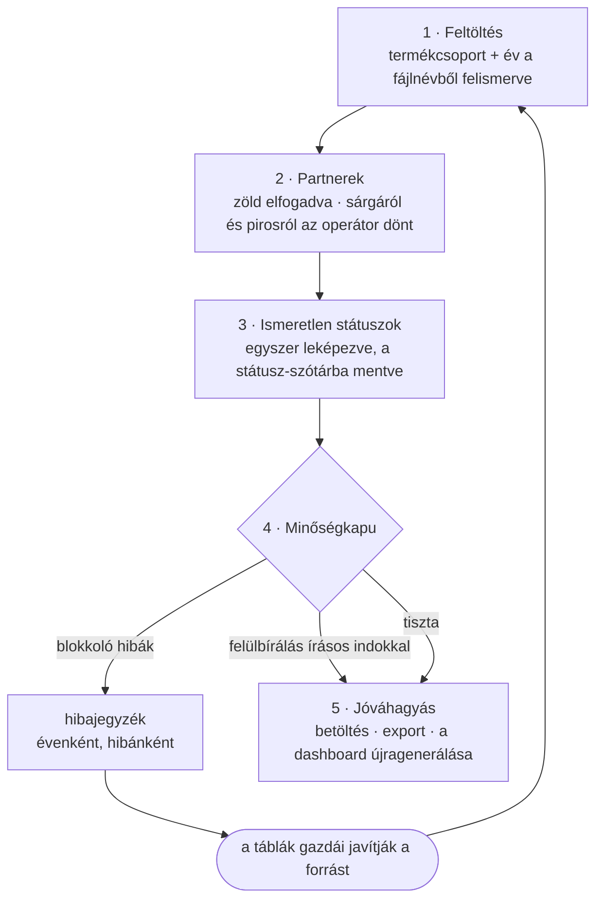

[English](../en/05-operator-workshop.md) · **Magyar** · [↑ README](../../README.hu.md)

# Az operátori műhely — akik az adatot gépelik, azok is a körben vannak

## Miért műhely, és miért nem csak egy szkript

Ebben az adatban a hibák nem egyszeriek. **Emberek gépelik be őket, minden héten** — azok, akik a
munkájuk részeként vezetik a munkafüzeteket. Egy szkript, amely negyedévente csendben kitisztítja az
adatot, az okot érintetlenül hagyná — és minden újfajta hibához fejlesztő kellene.

Ezért a csővezeték kapott egy kis webalkalmazást (Flask, 28 útvonal), ahol az operátor importálja a
fájlokat, meghozza az ítéleteket, és előállít egy **hibajegyzéket, amely visszamegy a táblák
gazdáihoz**.

## Az import, lépésről lépésre

| lépés | mit lát az operátor | kód |
|---|---|---|
| 1 feltöltés | a fájlokat, a felismert termékcsoportot és évet, a sorok számát | `admin/routes/import_wizard.py` |
| 2 partnerek | minden új írásmódot a legjobb találatával, pontszámával és zónájával; a piros neveket egymással is összevetve | `admin/etl_bridge.py` (staging), [Névegyesítés](03-entity-resolution.md) |
| 3 státuszok | azokat a státuszokat, amelyeket egyik térkép sem ismer, és hogy hány ajánlaton szerepelnek | `import_wizard.py` (státuszok), `admin/routes/status_dict.py` |
| 4 minőségkapu | blokkoló hibák és figyelmeztetések, ajánlatonként | `etl_bridge.py::collect_blocking_issues` |
| 5 jóváhagyás | betöltés az elemzési DB-be, a JSON exportja, az oldal újragenerálása | `etl_bridge.py` → ugyanazok az ETL-modulok, mint a kötegelt futásnál |

A varázslónak nincs saját olvasó- vagy átalakító logikája: **ugyanazokat az ETL-modulokat hívja**,
mint a kötegelt futás, így az operátori és a kötegelt út nem érthet mást ugyanazon a soron.

## A minőségkapu

| hiba | súlyosság | miért |
|---|---|---|
| megnyert ajánlat **munkaszám nélkül** | **blokkoló** | az üzlet nem kapcsolható a rendelés-nyilvántartóhoz — a realizált árbevétel számaiból csendben kimaradna |
| nyers partnernév, amely semmivel nem egyezik, és nem született róla döntés | **blokkoló** | az ajánlatnak nem lenne vevője |
| hiányzó ország | figyelmeztetés | a belföldi / külföldi bontásban lyuk lenne |
| hiányzó megkeresés-dátum | figyelmeztetés | az azonos időszaki összevetések és a reakcióidő elcsúsznak |
| 90 napnál hosszabb reakcióidő | figyelmeztetés | általában elírás egy dátumban |

A blokkoló hiba felülbírálható — de csak **írásos indokkal**, amely a menettel együtt tárolódik, és
a szerver is kikényszeríti (2026 októberéig csak az űrlap kérte).
„Majd később javítjuk" lehetséges; „csendben javítjuk" nem.

## A kör, mérve

Minden évet először önmagában importáltunk (2026. március 4–10.), aztán az összes aktív évet együtt.
Az évenkénti első import megmutatja, hol volt a kosz:

| év | blokkoló hibák az első importnál |
|---|---:|
| 2020 | 104 |
| 2021 | 167 |
| 2022 | 26 |
| 2023 | 0 |
| 2024 | 1 |
| 2025 | 9 |
| 2026 | 0–1 |

A legrégebbi évek — amelyeket a munkafüzetek előtt egy CRM-ben vezettek — messze a legkoszosabbak
voltak; később teljesen kikerültek a betöltésből (lásd [Beolvasás](02-ingestion.md#terv-vs-megépült)).
Az aktív évek szinte tisztán érkeztek, de a kapu sosem hallgat el: a júniusi összevont importok még
3, illetve 7 sort megállítottak, mindegyik munkaszám nélkül begépelt megnyert üzlet volt. A megállított
sorok visszamentek a forrásba, és a következő import átment — általában egy napon belül.

*Forrás: az operátori DB import-menetei (34 menet, 2026. március 4. – június 24.).* Az összes menetben
a kapu 1 918 hibát rögzített: 347 blokkolót (ebből 346 „megnyert, munkaszám nélkül"), 1 571
figyelmeztetést. Minden év hibajegyzéke munkafüzetként ment a táblák gazdáihoz, plusz egy összevont
lista az aktív évekre.

## A második kör: a rendelés-nyilvántartó

2026 júniusában bekötöttük a rendelés-nyilvántartót (amit évente ténylegesen leszerződtünk). Az
ajánlatokkal való egyeztetése egy második, kategorizált hibajegyzéket adott — ezt a
`scripts/extract_work_orders.py` írja ki munkafüzetként:

| kategória (2026. októberi futás) | darab |
|---|---:|
| megnyert ajánlat, de az ajánlaton nincs munkaszám | 31 |
| rendelés, amelynek ajánlata nincs megnyertként jelölve | 26 |
| rendelés, amelyhez egyáltalán nincs ajánlat | 17 |
| gyanús időbeli elhatárolás évek között | 8 |
| átsorolandó (harmadik divízió) | 6 |
| ugyanaz a munkaszám két vevőnél | 6 |
| megnyert ajánlat, amelyhez nincs rendelés | 4 |
| elírás a munkaszámban | 4 |

*(Az októberi riportban 110 tétel szerepelt; az október 13-i futás 112-t listáz.)* A legnagyobb
kategória gyökéroka egyszerű volt: a megnyert ajánlatoknak csak töredékénél rögzítették a
munkaszámot. A választott megoldás egy **tömeges, a táblák gazdái által kitöltendő lista** lett,
nem egy heurisztika, amely kitalálja a kapcsolatot.

## Mi van még a műhelyben

| képernyő | mire való |
|---|---|
| partnerek | lista, keresés, szerkesztés (ország, megjegyzések), két partner **összevonása** indokkal, az összes alias megtekintése |
| státusz-szótár | az operátorok által felvett státuszok, szerkeszthetően |
| újragenerálás / visszaállítás | az oldal újraépítése az aktuális DB-ből; vagy az elemzési DB visszaállítása és újraépítése a nulláról |

## Terv vs megépült

| terv | megépült | megjegyzés |
|---|---|---|
| egy tisztító szkript | egy tisztító szkript **és** köré egy operátori alkalmazás | az ítéleteknek kellett egy hely és egy ember |
| a hibák javítása a DB-ben | hibajegyzék a forrás gazdáinak | a következő negyedév fájlja ugyanazokat a hibákat hozná vissza |
| minden probléma blokkolása | két súlyossági szint, felülbírálás indokkal | ha egy figyelmeztetés is mindent megállítana, minden import elakadt volna |
