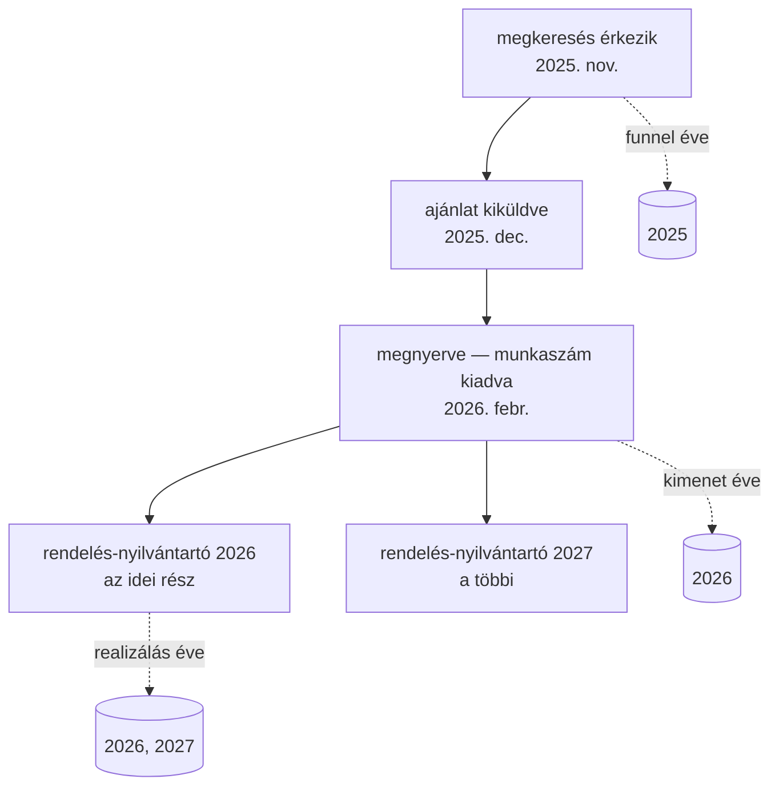

[English](../en/06-business-definitions.md) · **Magyar** · [↑ README](../../README.hu.md)

# Üzleti definíciók — hogyan lesz egy szám védhető

A tiszta adat szükséges, de nem elégséges. Egy bank előtt a *„mennyit ajánlottunk ki tavaly?"*
kérdésre minden alkalommal ugyanazt a választ kell adni, bárki számolja is — és a válasznak ki kell
állnia a következő kérdést is: *„és pontosan hogyan számoltátok?"*. Ez **leírt definíciók** kérdése:
egyszer, a megbízóval együtt meghozva, és ugyanúgy alkalmazva az SQL-ben, a dashboardon és a riportban.

## A definíciók

| fogalom | definíció | a mögötte álló döntés |
|---|---|---|
| **megkeresések** | minden sor: minden beérkezett ajánlatkérés | a keresletet az méri, ami bejött, akkor is, ha sosem ajánlottunk rá |
| **kiadott érték** | azon sorok értékének összege, ahol a státusz ≠ *nem készült ajánlat* | egy általunk elutasított kérés nem a mi ajánlatunk — különben egyetlen elutasított óriáskérés egy egész évet eltörpítene (lásd [A káosz, D4](01-the-mess.md#d-sorok-amelyek-nem-azok-aminek-látszanak)) |
| **nyert / vesztett / elhalasztva** | státusz = nyert; a státusz *vesztett*-tel kezdődik (versenytárs nyert, vagy a vevő visszalépett); státusz = elhalasztva | a vesztett szándékosan két állapot: „a versenytárs nyert" és „a vevő projektje meghalt" két különböző történet |
| **nyitott** | kiajánlva + előkészítés alatt | |
| **válasz nélkül lezárt** | ajánlat, amelyre 90–120 napig nem jött válasz, utólag lezárva | **nem számít vesztettnek** — tudatos döntés: a hallgatás nem „nem". Évenként mérve, ha vesztettnek számítanánk, a 2. termékcsoport win rate-je a töredékére esne (az 1. alig mozdul) |
| **win rate** | nyert / (nyert + vesztett), darabszám szerint, csak a lezárt ajánlatokon | a nyitott és a válasz nélküli ajánlatok nem hígítják |
| **konverzió** | nyert érték / kiadott érték | a pénz oldali nézet; csökken, amíg egy nagy pipeline még nyitott |
| **élő pipeline** | kiajánlva, a megkeresés az adatbeli legutolsó megkereséstől számított 12 hónapon belül érkezett | a régebbi nyitott ajánlatok **elavultak**, külön listázva, a forrásban lezárandók — ezek fújták fel a pipeline-t (`sql/views/04_pipeline.sql`) |
| **belföldi / külföldi** | a partner országából származtatva; ország = akivel üzletelünk | lásd lent |
| **új / visszatérő partner** | az első év, amikor a partner az adott termékcsoportban megjelenik / korábban már megjelent | a teljes történethez mérve, az archivált éveket is beleértve |

## Melyik évhez tartozik egy üzlet?

Ugyanaz az üzlet jó lelkiismerettel három különböző évhez is tartozhat:

| kérdés | év-alap | hol használjuk |
|---|---|---|
| „mennyi kereslet jött be, és mit kezdtünk vele?" | **megkeresés éve** | a funnel, a dashboard, a riport éves táblái |
| „hogyan alakul a win rate-ünk?" | **kimenet éve** (a munkaszám éve, ennek hiányában a megkeresés éve) | a teljesítmény-scorecard nézet |
| „mennyit szerződtünk ténylegesen idén?" | **nyilvántartás éve, időbeli elhatárolással** — egy több éves rendelés minden évben az adott évre eső részével számít | realizált árbevétel (rendelés-nyilvántartó) |

A két „nyert" szám — a funnel *nyert* értéke a megkeresés éve szerint és a *realizált* a
nyilvántartás éve szerint — **eltér, és mindkettő helyes**. Mindig egymás mellett mutatjuk őket,
ezzel a magyarázattal, sosem összemosva. Az évhatáron átnyúló üzlet jelölést kap (`is_crossyear`),
hogy megmagyarázni lehessen, ne elrejteni.

## Azonos időszak, tört év, előrevetítés

- **Azonos időszak:** a korábbi évekkel való összevetés **ugyanazt a naptári időablakot** használja
  (január 1. → az idei legutolsó megkeresés dátuma), nem a teljes előző évet.
- **Tört év:** a folyó évet mindig tört évként jelöljük.
- **Előrevetítés:** lineáris évesítés (365 / eltelt napok), külön mutatva és így felcímkézve — sosem
  keverve egy ténytáblába.

## Ország — és a módszertani megjegyzés

A belföldi / külföldi bontás a banki riport magja. A szabály — **ország = akivel ténylegesen
üzletelünk** — elemzési szempontból helyes, és időnként rossznak látszik: egy itthon bejegyzett cég
lehet „külföldi", mert minden kapcsolat, rendelés és számla a csoportja külföldi üzeméhez megy; egy
külföldi csoport hazai leánya pedig „belföldi".

Egyetlen ilyen, megmagyarázatlan sor miatt egy átnéző az egész táblában kételkedhet. Ezért minden
kívülállónak mutatott országbontás mellett ott van egy rövid **módszertani megjegyzés, amely
megnevez egy ilyen esettípust**. Maguk a döntések partnerenként az operátori DB-ben tárolódnak (331
kézi döntés), így minden negyedévben ugyanúgy érvényesülnek.

## Mit táplálnak a definíciók

**A banki riport** — kézzel írt, minden száma minden frissítéskor az adatbázisból újraszámolva:
éves funnel termékcsoportonként, belföldi / külföldi / összesen bontásban; az azonos időszaki
összevetés; előrevetítés a tört évre; realizált rendelések a nyilvántartóból; új vs visszatérő
partnerek; földrajzi szórás. Jelenleg a 7. változatnál tart; a v4 óta minden változat megvan,
egymás mellett.

**A dashboard** — egyetlen görgethető oldal év- és termékcsoport-választóval; minden grafikonnak van
táblázatos párja; minden szakasz megnevezi a definícióját. Létezik és használják — de ez a projekt
legkevésbé érdekes része: a munka abban van, hogy a számai igazak legyenek.

*A repó szintetikus adatkészletéből renderelve — nincsenek benne valódi számok. A feliratok magyarok, mint az éles rendszerben.*

## Terv vs megépült

| terv | megépült | megjegyzés |
|---|---|---|
| „mutassuk a számokat" | leírt definíciók, ugyanúgy alkalmazva az SQL-ben, az oldalon és a riportban | a definíciók voltak az a termék, amire a banknak valójában szüksége volt |
| egy „nyert" szám | kettő, egymás mellett, megnevezett év-alappal | összemosni őket egyszerűbb lett volna, és hibás |
| válasz nélkül lezárt = vesztett | külön tartva, nem számít vesztettnek | üzleti döntés, és ekként rögzítve |
| pipeline = minden nyitott | élő (12 hónap) vs elavult | a régi nyitott ajánlatok zajt jelentettek, nem lehetőséget |
