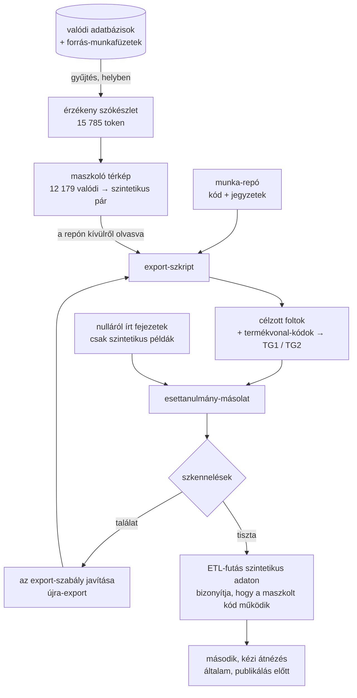

[English](../en/10-data-protection.md) · **Magyar** · [↑ README](../../README.hu.md)

# Adatvédelem — hogyan anonimizáltuk ezt a repót

A projekt egy megbízó kereskedelmi adatain épült: vevőnevek, kapcsolattartók, árak, üzletek.
Ebből semmi nincs ebben a repóban. Ha valaki az adataival dolgoztat, így bánnék az övével is —
ezért itt leírom az eljárást, azzal együtt, amit menet közben elkapott.

## A szabályok

| szabály | a gyakorlatban |
|---|---|
| **a megbízó nincs megnevezve** | sem a cég, sem az iparág, sem a termékek — a két termékvonal *1. / 2. termékcsoport* (a kódban `TG1` / `TG2`) |
| **nincs valódi rekord, érték vagy azonosító** | a dokumentációban, a kódban és a képernyőképen minden cég, személy, ajánlatszám, munkaszám és összeg szintetikus |
| **csak összesített darabszámok** | a mérőszámok sorok és döntések darabszámai (pl. „331 kézi ország-döntés”), az élő rendszeren mérve — sem érték, sem név, sem vevőnkénti adat |
| **a maszkoló anyag sosem kerül a repóba** | a valódi nevek listája és a maszkoló térkép csak azon a gépen él, ahol az adat |
| **friss repó** | export-szkript építi, a munka-repó git-története nélkül |

## Az eljárás

1. **Gyűjtés.** Egy külön, csak helyben dolgozó ügynök a valódi adatbázisokból és dokumentumokból
   összegyűjtött minden érzékeny tokent: cégneveket minden írásmódjukkal, normalizált alakokat,
   jellegzetes márkaszavakat, személyneveket, e-mail-címeket és domaineket, termék- és iparági
   kifejezéseket, forrásfájl- és lapneveket, a megbízó nevét minden írásmódban, személyes
   útvonalakat — 15 785 token, 1 024 cégcsoport és 1 513 személy. Az általános szavak (országnevek,
   „group”, „service” …) szándékosan kimaradtak a listából, és külön átnézésre kerültek, hogy a
   szkenner értelmes maradjon.
2. **Maszkolás.** Egy valódi → szintetikus térkép (`Cég 0001`, `Kapcsolattartó 0001`,
   `termékcsoport1` …) fut végig minden exportált kódfájlon. Egy token csak ott cserélődik, ahol
   önálló szóként áll — betűhöz vagy számhoz nem tapad —, és országnevet sosem maszkol.
3. **Foltozás.** Amit egy szó szerinti térkép nem tud javítani, azt név nélküli szabályok írják át
   az export-szkriptben: egy beégetett vevő → ország tipp-tábla kiürül; egy módszertani megjegyzés,
   amely valódi eseteket nevezett meg, most az esetek *típusát* írja le; egy valódi darabszámhoz
   rögzített keresztellenőrzés megtartja a mechanizmust, de a számot nem; a munkaszám-példák egy
   szintetikus 900-as sorszám-blokkba kerülnek; egy űrlap-placeholderként használt ágazati kód és
   egy vevőszegmenseket felsoroló megjegyzés semlegesítve; a termékvonal-kódok `TG1` / `TG2` lettek
   az azonosítókban, az SQL-ben és a címkékben.
4. **A dokumentáció nulláról.** Egyik fejezet sem egy projektjegyzet szerkesztett másolata; minden
   példasort az általa illusztrált hiba*típushoz* találtunk ki.
5. **Szkennelés** — lásd lent. Bármely találat az export-szabályt változtatja meg, sosem kézzel a
   kimenetet, és az export újrafut.
6. **Futtatás.** Az exportált ETL végigfut a szintetikus adathalmazon
   (`samples/generate_synthetic.py`); a repó dashboard-képe ennek a kimenete.
7. **Kézi átnézés**, mielőtt bármi nyilvános lesz.

## A szkennelések

| szkennelés | mit keres | eredmény a végső másolaton |
|---|---|---|
| valódi-név lista | mind a 15 785 token, kis-/nagybetűtől függetlenül, bárhol — plusz 448 rövid token egész szóként | 0 valódi név; a maradék találatok hétköznapi magyar szavak belsejében álló töredékek (egyenként átnézve) |
| érték-szkennelés | minden 3+ jegyű szám a valódi adat 5 077 különböző összegével szemben | 0 valódi összeg; a maradék egyezés kódkonstans (CSS-vastagság, HTTP-kód, port), mérőszám-darabszám vagy a szintetikus 900-as blokk |
| azonosító-minták | valódi ajánlatszám-, iktatószám- és munkaszám-alakok, adó- és közösségi adószámok | csak az általános `PM-0001` helyettesítőkulcs-példa |
| általános szkenner | e-mail-cím, IBAN, adószám, IP, titkok, személyes útvonal, más projektek | tiszta (az űrlap-placeholderek csupa nullák) |
| szótövek | minden termék- és iparági kifejezés töve, hogy csonkolt alak se csússzon át | 0 |
| termékvonal-kód maradvány | az eredeti kétbetűs kódok bármilyen azonosító-alakban | nincs |
| diff-átnézés | minden kódsor, amit az export megváltoztatott, teljes terjedelmében elolvasva | nincs elrontott kód; minden változás szándékos |

## Amit a szkennelések elkaptak — őszintén

Az eljárás azért létezik, mert az első próbálkozások nem voltak tiszták. Ezek mind elakadtak,
mielőtt bármi elhagyta volna a gépet:

| mit | mi kapta el | javítás |
|---|---|---|
| az első maszkoló kör rövid tokeneket **szavak belsejében** cserélt — eltörte az SQL `INTEGER`-t, a HTTP `POST`-ot és egy függvényhívást | diff-átnézés | szóhatáros illesztés; két karakteres vagy rövidebb token és országnév sosem maszkolódik |
| egy valódi cég kötőjeles írásmódja egy módszertani megjegyzésben hiányzott a térképből | név-szkennelés | a megjegyzés most az esettípusokat írja le, nem eseteket nevez meg |
| egy dokumentációs példa három összege **valódi tételérték** volt, amit az AI egy korábbi, az adaton végzett munkamenet után emlékezetből írt be | maga az AI, a vázlata újraolvasásakor — még mielőtt érték-szkennelés létezett | bekerült az érték-szkennelés, és azóta minden exportnál fut |
| egy keresztellenőrzésbe rögzített valódi éves darabszám | az export futtatása szintetikus adaton (az ellenőrzés elbukott) | a mechanizmus maradt, az érték kikerült |
| egy **csonkolt termékszó** (szótő, nem a teljes kifejezés) az import-varázsló fájltípus-felismerésében és a feltöltő oldalon | egy friss szemmel olvasó átnéző ügynök a kész repón — a név-szkennelés csak teljes szavakat ismert | a felismerés most a semleges `tg1` / `tg2` jelölőkön alapul; bekerült egy **szótő-szkennelés** |
| egy ágazati kód űrlap-placeholderként; egy vevőszegmenseket felsoroló megjegyzés | érték-szkennelés; kézi átnézés | semlegesítve |

A tanulság, amit levontam: **egy AI, amely dolgozott a valódi adaton, a kontextusában hordozza
azt.** A kód maszkolása nem elég — mindennek, ami utána íródik, a dokumentációt is beleértve, ugyanazokon
a szkenneléseken kell átmennie, mint a kódnak.

## Ami itt még „valódi” — szándékosan

- **Összesített darabszámok** a rendszerről és a munkáról (sorok, döntések, menetek, hibák). Az
  erőfeszítést írják le, nem az üzletet, és senkit nem azonosítanak.
- **A módszer és a szókészlete**: az oszlopelrendezés-korszakok, a magyar státusz-szavak, a
  hibatípusok. Ez az esettanulmány tárgya.
- **Általános termék-tulajdonságok** a tételsor-modellben (típus, anyag, mennyiség, egy
  méret-paraméter). Az egyetlen tulajdonság, amely a termék alakjára utalt, át lett nevezve.

## Terv vs megépült

| terv | megépült |
|---|---|
| „cseréljük ki a cégneveket” | összegyűjtött szókészlet, repón kívül tartott maszkoló térkép, név nélküli folt-szabályok, hét szkennelés, diff-átnézés, szintetikus futtatás, kézi átnézés |
| egyszer szkennelünk a végén | minden export után szkennelünk — minden találat egy szabályt változtatott meg, nem a kimenetet |
| a kód a kockázat | a dokumentáció is kockázat volt: az AI, amely írta, látta az adatot |
